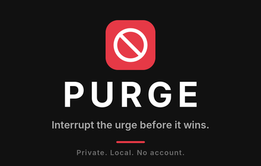

# Purge



**Purge puts friction between you and the websites you're trying to avoid.**

When you visit a blocked site, Purge stops the page from loading and walks you
through a short reset: name what's triggering you, rate the urge, pause, move
away from the screen, and choose something else to do. Then you check in again
and see how the urge changed.

Over time, a dashboard shows your streak and your patterns: what triggers you
most, what time of day is riskiest, and which activities help most.

## Features

- Blocks the sites on your list, including their subdomains
- Editable starter list; add or remove any site in Settings
- Guided reset: trigger, urge rating, countdown, leave the room, replacement activity, check-in
- Dashboard with streak, success rate, risky times, triggers and best interventions
- Streak that counts up daily and can be reset manually
- Strict mode: type a confirmation phrase before lowering your guard
- Fully private: no account, no servers, no analytics. Everything stays in your browser

## Install (Chrome and other Chromium browsers)

Purge isn't on the Chrome Web Store, so you load it manually:

1. Download this repo: click **Code → Download ZIP** and extract it, or run `git clone`.
2. Open `chrome://extensions` and turn on **Developer mode** (top right).
3. Click **Load unpacked** and select the folder that contains `manifest.json`.
4. Pin Purge from the puzzle-piece menu so the icon stays visible.

After pulling changes or editing any file, click the reload icon on Purge's card.

## How it works

Purge is plain HTML, CSS and JavaScript with no build step and no dependencies.

```
manifest.json      Extension config (Manifest V3)
background/        Service worker: watches navigation, blocks, logs attempts
blocked/           The intervention screen
popup/             Toolbar popup
dashboard/         Stats page
settings/          Blocked sites, protections, data deletion
shared/utils.js    Shared helpers: dates, streak, stats, settings, starter list
assets/icons/      Extension icons
```

Permissions are kept to the minimum:

- `webNavigation` to notice when you navigate to a site on your blocked list
- `storage` to save your list, settings and history locally

All data is stored with `chrome.storage.local` on your device. Nothing is
transmitted anywhere. You can delete your history from the Settings page.

## Limitations

Purge is a self-control tool, not a lock. You own your browser, so you can
always disable the extension or use a different browser.

- Chrome doesn't run extensions in Incognito by default. To block there too,
  open `chrome://extensions`, click **Details** on Purge and turn on
  **Allow in Incognito**.
- Blocking is by domain, so mirrors and new sites need to be added to your list.
- Purge is not a medical product or a substitute for professional support.

## Contributing

Issues and pull requests are welcome. Ideas: a larger maintained blocklist,
a cooldown period for removing sites, Firefox support, export/import of data.

## License

[MIT](LICENSE.txt)
